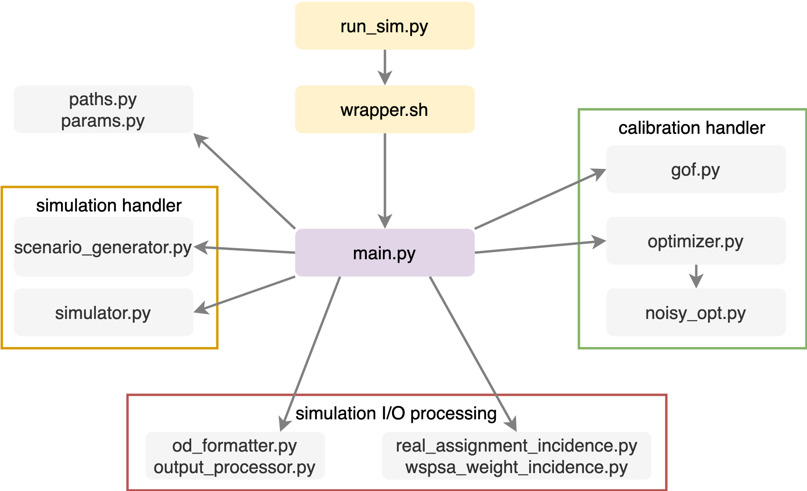

# actrys (Automated Calibration for Traffic Simulations)

[](https://github.com/vishalmhjn/actrys/actions/workflows/main.yml)

**actrys** is a Python-based platform designed for calibrating traffic simulations in SUMO (Simulation of Urban Mobility).

<p align="center">
  
</p>

<p align="center">
  
</p>

## 1. Overview

This repository includes code for:

- **Input/Output Interfaces**: To interact with SUMO, initialize and simulate scenarios, and collect output data.
- **Calibration Components**:
  - Optimization Strategies: SPSA, W-SPSA, Bayesian optimization.
  - Goodness-of-Fit Criteria.
- **Assignment Matrix Extraction**: Based on the simulated routes.
- **Synthetic Simulator**: For prototyping with static traffic assignment.
- **Utilities**: For preparing and processing SUMO input files, such as network downloading, trip filtering, adding detectors, and file format conversion.
- **Plotting Tools**.

## 2. Framework

The platform follows a step-wise approach for sequential calibration of:

- Demand parameters or Origin-Destination (OD) flows.
- Supply parameters for mesoscopic simulations.

To achieve this, the following process is followed:

1. **Bias-Correction in OD Matrices**: Using a one-shot heuristic.
2. **Bayesian Optimization**: Fine-tuning SPSA parameters using an analytical or static assignment matrix approximated from the simulator.
3. **W-SPSA with Ensembling Techniques**: Including cold and warm restarts.
4. **Supply Calibration** using Bayesian optimization.

Currently, the platform can handle link-based Measures of Performance (MOP) such as link traffic counts and link speeds in the calibration process.

This platform can calibrate two types of scenarios:

- **Analytical or Static Simulator**: Used for prototyping, this scenario generates a random assignment matrix controlled by different parameters to map OD flows to link counts. No external data files are needed to run this scenario, except for a few parameters that control the scenario properties.

- **Black-box or Dynamic Simulator (SUMO)**: This scenario includes:
  - Creation of trips from time-dependent OD matrices.
  - Routing for trips based on the route-choice algorithm.
  - Dynamic network conditions, traffic propagation, and re-routing.

## 3. Architecture

<p align="center">

</p>

The code is an installable Python package (`src/actrys`):

| Module | Purpose |
| --- | --- |
| `config` | Typed run configuration (dataclasses) loaded from TOML files |
| `metrics` | Goodness-of-fit measures (RMSN, WMAPE, SMAPE, ...) and W-SPSA deviations |
| `optim` | SPSA, W-SPSA (sparse weight matrices) and PC-SPSA behind one `Objective` interface |
| `synthetic` | Analytical (static assignment) scenario generator |
| `sumo` | SUMO formats and tool chain: O-format OD matrices, detector/edge/route output parsing, `od2trips` → `duarouter` → `sumo`, incidence/assignment matrices |
| `calibration` | Objectives, bias correction, Bayesian tuning, and the two pipelines (`SumoCalibration`, `SyntheticCalibration`) |
| `plotting` | 45-degree plots and loss curves |
| `cli` | `actrys` command |

Scenario-preparation tools (network download, TAZ creation, detector files, ...) are in [`scripts/`](scripts/).

## Input Preparation for SUMO Simulations

**Black-box or dynamic simulator** scenarios require several formatted inputs. Example files are provided in the [munich](munich/) directory:

- **Network File**: A standard SUMO network [(Example)](munich/network.net.xml).
- **OD Matrices**: Time-dependent OD matrices in SUMO's O-format, one file per interval named `<prefix>_<from>_<to>.txt` (e.g. `OD_7.0_8.0.txt`), plus an `od_list.txt` listing the OD pairs [(Example)](munich/demand/).
- **Link Sensors**: A file specifying the properties (location and data collection frequency) of `e1Detector`/`inductionLoop` sensors and `edgeData` outputs [(Example)](munich/additional.add.xml).
- **Traffic Analysis Zones**: Mapping between origin-destination zones and network edges [(Example)](munich/tazes.taz.xml).

## 4. Custom Synthetic Scenario with SUMO

For a custom synthetic scenario, the following process is followed:

1. A true demand is simulated to obtain "_real sensor measurements_."
2. Subsequently, the true demand is perturbed by the addition of bias and variance.
3. Perturbed demand is simulated, and corresponding simulation sensor measurements are compared with the "_real sensor measurements_." Based on the discrepancy between real and simulated data, the calibrator aims to recover the true demand matrix.

## 5. Custom Real Scenario with SUMO

For a real scenario, you can use real sensor data such as link volumes or link speeds. These measurements could be obtained from open data sources, traffic operator websites, or city open data portals. In this case, additional input is needed to use the observed counts as an input:

1. **Observed Sensor Data**: Link counts (`det_id,count,hour`) and/or speeds (`det_id,speed,hour`), where `det_id` is the SUMO edge id and `hour` the interval start in seconds, plus the list of detectors that can be matched to the network [(Example)](munich/sample_real_world_data/).

2. In a real scenario, the true demand is not known. What you have is an initial demand matrix, which is simulated. Corresponding simulation sensor measurements are compared with the real sensor measurements. Based on the discrepancy between real and simulated data, the calibrator aims to recover the true demand matrix.

## 6. Installation

Python ≥ 3.11 is required. SUMO is needed for the dynamic scenarios: either install it from [eclipse.dev/sumo](https://eclipse.dev/sumo/) and set `SUMO_HOME`, or install the `eclipse-sumo` wheel via the `sumo` extra (tested with SUMO 1.13 and 1.28).

```sh
python3 -m venv .venv && source .venv/bin/activate
pip install -e ".[dev]"          # or ".[dev,sumo]" to also install SUMO
```

## 7. Execution

Runs are described by TOML files; see [`configs/`](configs/) for documented examples. Relative paths are resolved against the config file's directory. Any value can be overridden on the command line with `--set`.

### I. Analytical (static) scenarios

```sh
actrys synthetic configs/synthetic.toml
actrys synthetic configs/synthetic.toml --set algorithm=spsa --set gains.alpha=0.602 --set gains.gamma=0.101
```

The scenario size (zones, detectors, intervals) is configured in the `[scenario]` table. Outputs go to `synthetic_sims/<run_name>/`.

### II. SUMO scenarios with synthetic counts

```sh
actrys sumo configs/munich.toml
actrys sumo configs/munich.toml --set demand.bagging_runs=1 --set n_sequential=1 --seed 42
```

Outputs (estimated OD matrices, matched counts/speeds, `results_*.json`, plots) are stored in `munich/<run_name>/`.

### III. SUMO scenarios with real-world counts

Set `data.synthetic_counts = false` and point `data.real_counts`, `data.real_speeds` and `data.matchable_detectors` to your files, as in [`configs/munich_real_data.toml`](configs/munich_real_data.toml):

```sh
actrys sumo configs/munich_real_data.toml
```

### Python API

```python
from actrys.config import SumoCalibrationConfig, load_config
from actrys.calibration.sumo_pipeline import SumoCalibration

cfg = load_config(SumoCalibrationConfig, "configs/munich.toml")
results = SumoCalibration(cfg).run()
```

### Reproducibility

Set `seed` in the config (or `--seed`) for reproducible runs.

## 8. Development

```sh
make test        # unit tests + end-to-end SUMO tests on a small grid (skipped without SUMO)
make test-fast   # without the SUMO tests
make lint
```

## 9. Other SUMO-related tasks (optional)

### Network download
Download raw OSM data and convert it into a SUMO network using netconvert. Specify the extent of the network as a bounding box, and the network-building parameters, in [run_download.sh](scripts/run_download.sh):

```sh
sh scripts/run_download.sh
```

Other tools in [`scripts/`](scripts/) (each has `--help`): `generate_additional.py` (detector file from a detector → edge mapping), `shp_to_taz.py` / `sumo_network.py` (TAZs from zone polygons), `recursive_taz_filter.py` (remove TAZ edges causing unroutable trips), `apriori_demand.py` (time-dependent demand from a static OD table), `sumo_to_geojson.py`, `route_prevalence.py`, `detector_errors.py`.

## 10. Citation

If you use these codes in your work, kindly cite the following preprint:

Mahajan, V., Cantelmo, G., and Antoniou, C, Towards automated calibration of large-scale traffic simulations, [preprint_v2](https://mediatum.ub.tum.de/doc/1701188/1701188.pdf), 2023.

## 11. Acknowledgements

1. SUMO: https://github.com/eclipse/sumo
2. Noisyopt library: https://github.com/andim/noisyopt
