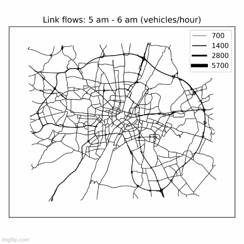
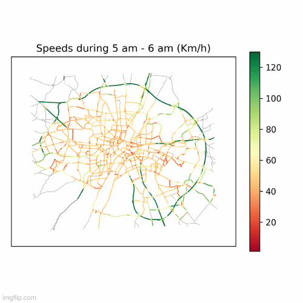
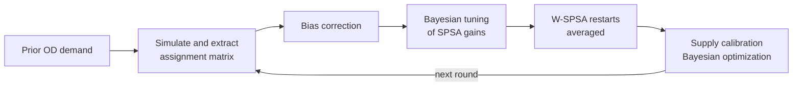

<h1 align="center">actrys</h1>

<p align="center">
  <strong>Automated calibration of large-scale traffic simulations</strong>
</p>

<p align="center">
  <a href="https://github.com/vishalmhjn/actrys/actions/workflows/main.yml"></a>
  
  <a href="LICENSE"></a>
</p>

<p align="center">
  
  &nbsp;
  
</p>

**actrys** calibrates [SUMO](https://eclipse.dev/sumo/) traffic simulations
against link measurements. Given observed traffic counts and speeds, it
estimates the **time-dependent origin–destination (OD) demand** and the
**mesoscopic supply parameters** that make the simulation reproduce them.

## Highlights

- **End-to-end pipeline.** Bias correction, Bayesian tuning of the optimizer,
  W-SPSA with ensembling, and supply calibration, run in sequential rounds.
- **Simulator in or out of the loop.** Calibrate with SUMO in the loop, or on
  an assignment matrix derived from its routes for fast iterations.
- **Scales to city networks.** Sparse W-SPSA weight matrices and vectorised
  assignment-matrix construction.
- **Prototyping without SUMO.** An analytical (static assignment) scenario for
  studying the algorithms in minutes.
- **Configuration as code.** Typed, validated TOML configurations, a
  command-line interface and a Python API.

## Contents

- [Installation](#installation)
- [Quick start](#quick-start)
- [Methodology](#methodology)
- [Scenarios](#scenarios)
- [Input data](#input-data)
- [Configuration](#configuration)
- [Outputs](#outputs)
- [Project structure](#project-structure)
- [Scenario-preparation tools](#scenario-preparation-tools)
- [Development](#development)
- [Citation](#citation)
- [Acknowledgements](#acknowledgements)
- [License](#license)

## Installation

Requires **Python 3.11 or newer**.

```sh
git clone https://github.com/vishalmhjn/actrys.git
cd actrys
python3 -m venv .venv && source .venv/bin/activate
pip install -e ".[sumo]"
```

The `sumo` extra installs SUMO from the `eclipse-sumo` wheel. To use an
existing installation instead, run `pip install -e .`, set `SUMO_HOME` and put
the SUMO binaries on your `PATH`. actrys has been tested with SUMO 1.13 and 1.28.

| Extra | Adds |
| --- | --- |
| `sumo` | SUMO binaries and tools |
| `dev` | pytest, ruff |
| `scripts` | Dependencies of the scenario-preparation tools (geopandas, overpy, ...) |

## Quick start

```sh
# Analytical scenario: no SUMO required, runs in minutes
actrys synthetic configs/synthetic.toml

# SUMO calibration of the Munich example with synthetic counts
actrys sumo configs/munich.toml

# A shorter, reproducible trial run
actrys sumo configs/munich.toml --set demand.bagging_runs=1 --set n_sequential=1 --seed 42
```

Results are written to `munich/<run_name>/` (SUMO) or `synthetic_sims/<run_name>/` (analytical).

## Methodology

Calibration runs in `n_sequential` rounds. Each round calibrates demand first,
then supply:



1. **Assignment matrix.** The prior demand is simulated. The simulated routes
   give the share of each OD pair observed by each detector.
2. **Bias correction.** A one-shot heuristic rescales the prior demand,
   globally (`naive`) or per OD pair (`weighted`), and sets the search bounds.
3. **Gain tuning (optional).** Bayesian optimization selects the SPSA step
   sizes `a` and `c`, cheaply, on the assignment-matrix approximation.
4. **Demand estimation.** Weighted SPSA (W-SPSA) restricts each gradient
   component to the measurements its OD pair affects. Several restarts
   (`bagging_runs`, cold or warm) are averaged. Each restart can run with SUMO
   in the loop, on the assignment matrix, or both.
5. **Supply calibration (optional).** Bayesian optimization of the rerouting
   and mesoscopic junction-penalty parameters.

The objective is a weighted sum of three goodness-of-fit terms (counts, speeds,
and deviation from the prior demand), with weights set in `[weights]`. The
available measures are RMSN, RMSE, SMAPE, RMSP, WMAPE and a composite of RMSN
and SMAPE.

## Scenarios

| Scenario | Command | Description |
| --- | --- | --- |
| **Analytical** | `actrys synthetic` | A random static assignment maps OD flows to counts; speeds follow a fundamental diagram. Needs no input files. |
| **SUMO with synthetic counts** | `actrys sumo` (`data.synthetic_counts = true`) | The scenario demand is simulated to produce ground-truth counts and speeds. The prior is that demand with added bias and noise; the calibration aims to recover the ground truth. |
| **SUMO with real counts** | `actrys sumo` (`data.synthetic_counts = false`) | Calibrates against field measurements, with the scenario demand as the prior. See [`configs/munich_real_data.toml`](configs/munich_real_data.toml). |

## Input data

A SUMO scenario is a directory such as [`munich/`](munich/):

| File | Description |
| --- | --- |
| `network.net.xml` | SUMO road network |
| `tazes.taz.xml` | Traffic analysis zones (zone → network edges) |
| `additional.add.xml` | `e1Detector` / `inductionLoop` sensors and `edgeData` outputs |
| `demand/OD_<from>_<to>.txt` | One OD matrix per interval in SUMO's O-format, e.g. `OD_7.0_8.0.txt` |
| `demand/od_list.txt` | The modelled OD pairs (`o d t`) |

Field measurements are CSV files (examples in
[`munich/sample_real_world_data/`](munich/sample_real_world_data/)):

| File | Columns |
| --- | --- |
| Counts | `det_id, count, hour` |
| Speeds | `det_id, speed, hour` |
| Matchable detectors | `det_id` |

`det_id` is the SUMO edge id and `hour` the interval start in seconds.

## Configuration

Runs are defined in TOML files. The examples in [`configs/`](configs/)
document every option. Relative paths are resolved against the configuration
file, and unknown or misspelled keys are rejected.

| Section | Purpose |
| --- | --- |
| `[scenario]` | Scenario directory, file names and output folder (`run_name`) |
| `[time]` | Analysis period, warm-up and cool-down, interval length |
| `[data]` | Synthetic or field measurements, prior bias and noise |
| `[weights]`, `estimator` | Objective weights and goodness-of-fit measure |
| `[demand]` | Algorithm, in/out-of-loop iterations, restarts, momentum |
| `[demand.gains]`, `[demand.out_of_loop_gains]` | SPSA gain sequences |
| `[demand.bias_correction]`, `[demand.autotune]` | Bias correction and Bayesian gain tuning |
| `[supply]`, `[initial_supply]` | Supply-calibration budget, bounds and initial values |
| `[simulation]` | Rerouting threads, parallel perturbations, `meso` / `micro` aggregation |

Any value can be overridden on the command line:

```sh
actrys sumo configs/munich.toml --set weights.speed=0.1 --set demand.in_loop_iterations=10
```

Set `seed` in the configuration, or pass `--seed`, for reproducible runs.

### Python API

```python
from actrys.config import SumoCalibrationConfig, load_config
from actrys.calibration.sumo_pipeline import SumoCalibration

config = load_config(SumoCalibrationConfig, "configs/munich.toml")
results = SumoCalibration(config).run()
```

`run()` returns the loss history and the calibrated parameters. The same
values are written to `results_<timestamp>.json`.

## Outputs

A SUMO run writes the following to `<scenario>/<run_name>/`:

| File | Content |
| --- | --- |
| `results_<timestamp>.json` | Loss history, run settings, calibrated supply parameters and tuned gains |
| `mean_<round>_<restarts>_{od,counts,speeds}.csv` | Ground truth or observations, initial and calibrated values for each round |
| `<restart>_od.csv` | Best OD vector of each restart |
| `OD_best_*.txt`, `OD_mean_*.txt` | Best and averaged demand in O-format, ready to simulate |
| `best_out.csv`, `best_edge_data_*` | Detector and edge outputs of the best simulation |
| `logs_spsa_tune.json`, `logs_supply.json` | Bayesian-optimization logs, reused when a run is restarted |
| `img_*.png` | Observed-versus-simulated scatter plots and loss curves |

Analytical runs write the equivalent files to `<output_dir>/<run_name>/`.

## Project structure

```
actrys/
├── configs/                 Example run configurations
├── scripts/                 Scenario-preparation tools
├── src/actrys/
│   ├── config.py            Typed configuration and TOML loading
│   ├── metrics.py           Goodness-of-fit measures
│   ├── optim/               SPSA, W-SPSA and PC-SPSA
│   ├── synthetic/           Analytical scenario generator
│   ├── sumo/                SUMO I/O, tool chain and assignment matrices
│   ├── calibration/         Objectives, bias correction, tuning and pipelines
│   ├── plotting.py          Diagnostic plots
│   └── cli.py               Command-line interface
└── tests/                   Unit and end-to-end tests
```

<p align="center">
  
</p>

## Scenario-preparation tools

Stand-alone utilities in [`scripts/`](scripts/) for building new scenarios.
Run any of them with `--help` for usage. Some need the `scripts` extra.

| Tool | Purpose |
| --- | --- |
| `run_download.sh`, `download_network.py` | Download OpenStreetMap roads for a bounding box and build a SUMO network |
| `generate_additional.py` | Create a detector file from a detector-to-edge mapping |
| `shp_to_taz.py`, `sumo_network.py` | Create traffic analysis zones from zone polygons |
| `recursive_taz_filter.py` | Remove zone edges that make trips unroutable |
| `taz_processor.py`, `gen_network.sh` | Keep the zones at the network boundary |
| `apriori_demand.py` | Build time-dependent demand from a static OD table |
| `sumo_to_geojson.py`, `route_prevalence.py`, `detector_errors.py` | Export the network, edge usage and per-detector errors for GIS |
| `visualizer.sh` | Plot network speeds and flows |

## Development

```sh
pip install -e ".[dev,sumo]"
make test        # full test suite, incl. end-to-end SUMO runs on a small grid
make test-fast   # without the SUMO tests
make lint        # static checks (ruff)
make format      # auto-format
```

The SUMO tests are skipped when no SUMO installation is found.

## Citation

If you use actrys in your research, please cite:

> Mahajan, V., Cantelmo, G., and Antoniou, C. (2023).
> *Towards automated calibration of large-scale traffic simulations*.
> [Preprint](https://mediatum.ub.tum.de/doc/1701188/1701188.pdf).

## Acknowledgements

- [Eclipse SUMO](https://github.com/eclipse/sumo), the simulation platform.
- [noisyopt](https://github.com/andim/noisyopt) by Andreas Mayer, the basis of
  the SPSA implementation.

## License

Released under the [MIT License](LICENSE).
